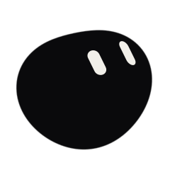

  

<h1 align="center">Rudra Tiwari</h1>

i like making things.

  <a href="https://rtx09x.github.io/">Website</a> ·
  <a href="https://www.linkedin.com/in/rtx09x/">LinkedIn</a> ·
  <a href="https://x.com/Rtx09x">X</a> ·
  <a href="https://huggingface.co/Rtx09x">Hugging Face</a> ·
  <a href="https://orcid.org/0009-0004-8521-7627">ORCID</a>

## About me

I build AI systems, developer tools and research software. I'm particularly interested in agent infrastructure, AI-assisted scientific discovery, quantum information and computational science.

I'm studying physical sciences with electronics and computer science at the University of Delhi, researching metamaterials at the Inter-University Accelerator Centre (IUAC), leading the GirlScript Delhi chapter, and serving as a Gemini campus ambassador.

Outside of that, I make music, build RC planes, tinker with hardware and get distracted by interesting problems.

## Currently building

**Catalyst** — An extensible AI coding agent harness and workspace for human–AI collaboration. Piko, the little creature above, comes from Catalyst.

**[Open Research](https://github.com/Rtx09x/Open-Research)** — An initiative for open, collaborative and AI-assisted research. The founding collection contains ten projects across mathematics, physics, computer science and engineering, with proofs, computational certificates and validation artifacts where applicable. The work awaits independent expert review.

**[TRIADS](https://github.com/Rtx09x/TRIADS)** — Tiny Recursive Information-Attention with Deep Supervision, a deep learning architecture for materials-property prediction in the small-data regime, evaluated on six Matbench tasks.

## Selected work

| Project | Description |
| :--- | :--- |
| [ANCP](https://github.com/TwentySevenLabs/ancp) | Agent Native Compiler Protocol: structured diagnostics, repair plans and verification. |
| [Agentic Provider Gateway](https://github.com/TwentySevenLabs/agentic-provider-gateway) | Provider-agnostic model gateway for agentic systems. |
| [Catalyst — Materials Discovery](https://github.com/Rtx09x/catalyst) | AI-native materials discovery workspace with graph exploration and grounded research tools. |
| [agentic-skills](https://github.com/Rtx09x/agentic-skills) | Executable skills and workflows for coding agents. |

## Research & contributions

- [Open Research — founding collection](https://github.com/Rtx09x/Open-Research#research)
- [TRIADS paper](https://doi.org/10.5281/zenodo.19200579) · [Model artifacts](https://huggingface.co/Rtx09x/TRIADS) · [Matbench contribution](https://github.com/materialsproject/matbench/pull/360)
- [Why "Infinite" Lossless Compression Fails](https://doi.org/10.5281/zenodo.18404002)
- OpenAI Parameter Golf: [#1694](https://github.com/openai/parameter-golf/pull/1694), [#1353](https://github.com/openai/parameter-golf/pull/1353)

---

Piko is adapted from <a href="https://github.com/jeremy-prt/bloub">Bloub</a> by Jérémy Perret (MIT).
